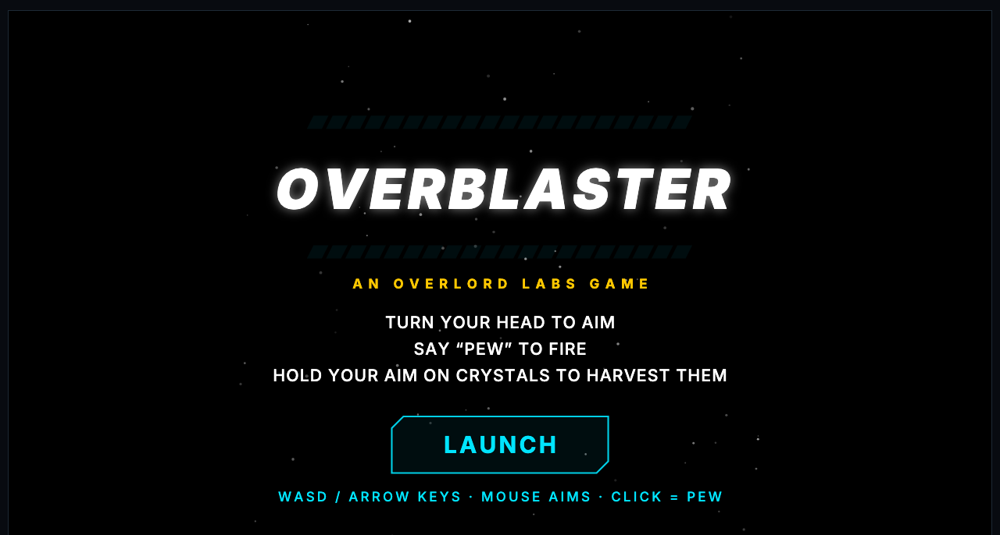
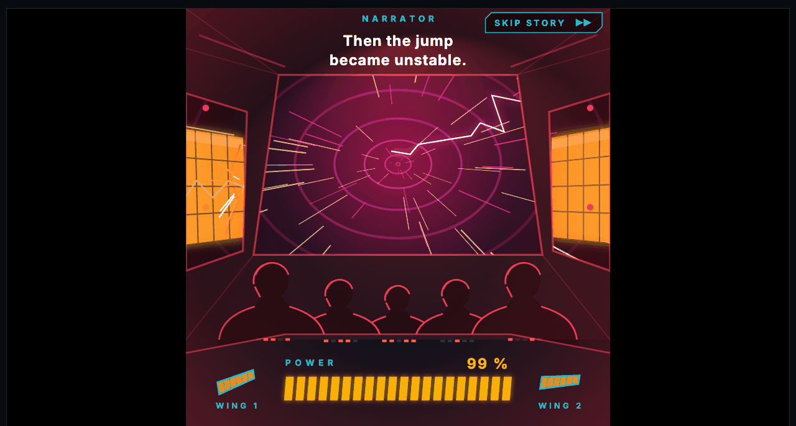
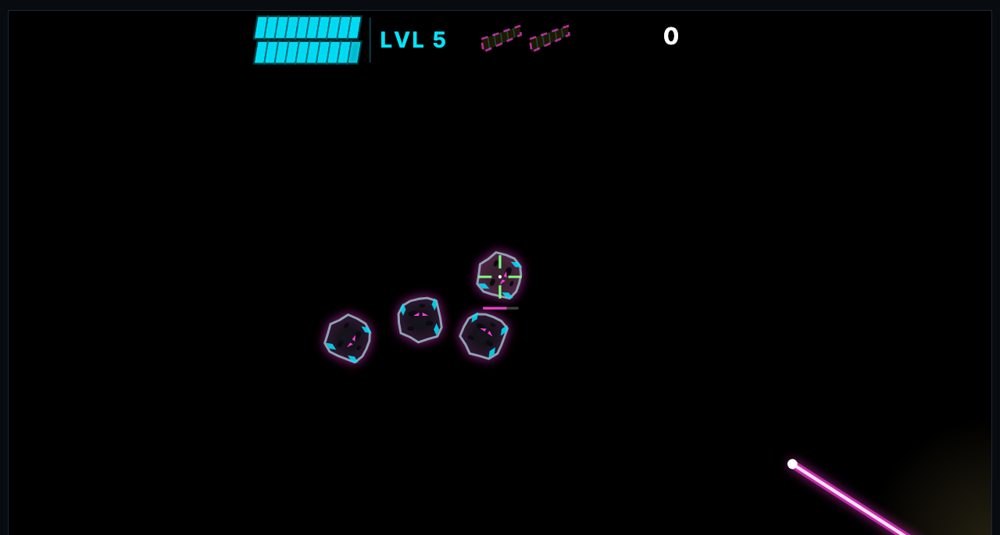
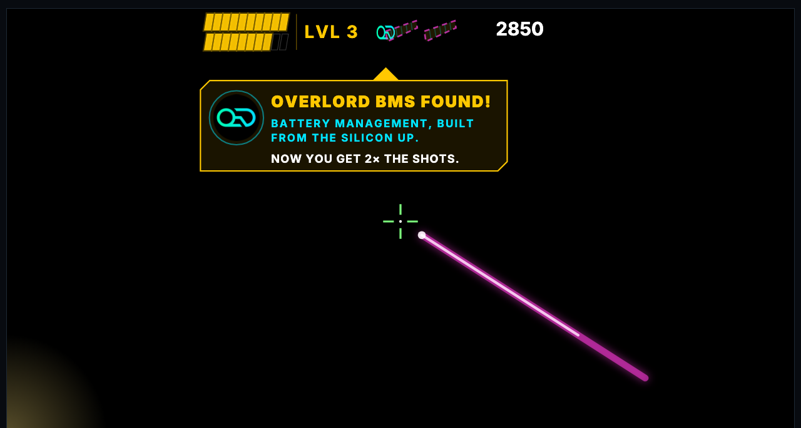

# OverBlaster (web)

**OverBlaster by OverLord Labs**: a head-aimed, voice-fired space shooter for the Raven smart glasses, as an embeddable web game.
Turn your head (arrow keys, WASD, a mouse or phone motion) to aim, say "Pew" (space, a click, or the microphone) to fire,
hold your aim on crystals to harvest them, and find the Overlord BMS chip that doubles your battery. Two of the Meridian's
battery wings are out there too, at levels 14 and 28.

TypeScript, no runtime dependencies, Canvas 2D + WebAudio. This is the web sibling of the Python app in `../Raven`.

| | |
|---|---|
|  |  |
| *Title. The glasses' square view sits in the middle of a wider window.* | *The story intro on the stranded Meridian's bridge: the jump goes unstable and the wings tear away.* |
|  |  |
| *Gameplay fills the browser width. The crosshair follows the mouse; a held click or Space is "Pew".* | *Level 3: the Overlord BMS is collected. It doubles your battery, and the badge stays in the HUD.* |

## Run it

```bash
npm install
npm run dev            # demo page with hot reload
npm test               # core rules, intro timeline, bot balance checks (headless)
npm run sim -- 1 42 3 1   # the bot plays levels 1-42, 3 seeds, aim noise 1.0
npm run build          # typecheck + demo site (dist/site) + library (dist/lib)
npm run build:single   # after build: one self-contained dist/overblaster.single.html (audio inlined, ~4 MB)
```

## Embed it

```html
<div id="game"></div>
<script type="module">
  import { OverBlaster } from "./overblaster.js";
  const ob = OverBlaster.mount(document.getElementById("game"), { assetsUrl: "/overblaster/" }); // serves audio/ and logo.png
  ob.on("gameOver", (e) => console.log(e.score, e.level));
</script>
```

or `<overblaster-game assets-url="/overblaster/"></overblaster-game>` after `defineElement()`. Full options and events: [docs/EMBEDDING.md](docs/EMBEDDING.md).

## How it is built

Three layers, and only the first holds the game. [docs/ARCHITECTURE.md](docs/ARCHITECTURE.md) explains them;
[docs/PORTING.md](docs/PORTING.md) is the guide for moving the game to another language or framework.

```
src/core/       the game: rules, levels, intro timeline, bot. Pure; no DOM, canvas, audio or clock.
src/render/     Canvas 2D drawing of a Game. Reads state, never writes it.
src/platform/   browser adapters: input -> InputFrame, sound events -> WebAudio, microphone.
src/index.ts    the embeddable API (OverBlaster.mount) and the <overblaster-game> element.
src/debug/      screenshot scenes (#test=wing:hold ...). Demo page only, not in the library.
public/         audio clips (m4a) and the logo.
```
